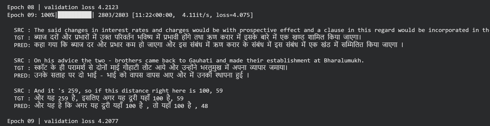

# English → Hindi Transformer (built from scratch in PyTorch)

An encoder–decoder **Transformer** for English → Hindi machine translation, written by hand in PyTorch as a **learning project**. Every block (embeddings, positional encoding, multi-head attention, encoder, decoder, cross-attention, residual connections, LayerNorm) is implemented in [`model.py`](model.py) — no `nn.Transformer`. Only the core attention math uses PyTorch's fused `scaled_dot_product_attention`.

> ⚠️ **Honest status:** this model was trained for only **10 epochs** and has **not been tuned**. It translates simple phrases reasonably but drops words, makes grammar mistakes and fails on numbers and long sentences. It is a learning exercise, not a production translator. See [Results](#results) and [Limitations](#limitations).

📹 A short captioned walkthrough is in [`assets/explainer_video.mp4`](assets/explainer_video.mp4).

---

## Architecture

| Hyper-parameter | Value |
|---|---|
| `d_model` (embedding size) | 256 |
| `N` (encoder & decoder layers) | 6 |
| `h` (attention heads, `d_k` = 32) | 8 |
| `d_ff` (feed-forward width) | 1024 |
| dropout | 0.1 |
| `seq_len` (max tokens) | 128 |

```
English sentence → tokens → Embedding × √d_model + sinusoidal positions
        └─► Encoder ×6 [ Multi-Head Self-Attention → Feed-Forward ]  (residual + LayerNorm)
                                   │ context vectors (keys & values)
Hindi so far → tokens → Embedding + positions
        └─► Decoder ×6 [ Masked Self-Attention → Cross-Attention → Feed-Forward ]
                └─► Linear + log-softmax → next Hindi word  (greedy decoding)
```

Implementation notes
- Pre-norm residual blocks: `x + dropout(sublayer(norm(x)))`
- Causal mask in the decoder; padding masks on both sides
- Word-level tokenizers (Hugging Face `tokenizers`, `WordLevel`, `min_frequency=2`; rare words become `[UNK]`)
- Sentence pairs longer than `seq_len - 2` tokens are filtered out
- Training: Adam (β = 0.9 / 0.98), peak LR 3e-4 with 1000 warm-up steps then cosine decay, label smoothing 0.1, gradient clipping 1.0, mixed precision (fp16 on T4, bf16 on Ampere+), TF32
- Seeded 90 / 10 train–validation split; validation loss and 3 sample translations printed every epoch
- Checkpoints every epoch with automatic resume (`preload = "latest"`), so Colab disconnects don't lose progress

## Project structure

```
├── model.py            # Transformer implementation (all blocks by hand)
├── dataset.py          # TranslationDataset, padding, causal mask
├── train.py            # tokenizers, data loaders, training loop, validation, greedy decode
├── translate.py        # load a checkpoint and translate a sentence
├── config.py           # all hyper-parameters and file paths
├── colab_run.ipynb     # run everything on a free Colab GPU
├── requirements.txt
└── assets/             # explainer video + training-log screenshot
```

## Dataset

Trained on the **Hindi–English parallel corpus** from Kaggle by *vaibhavkumar11*:

👉 <https://www.kaggle.com/datasets/vaibhavkumar11/hindi-english-parallel-corpus>

The dataset is **not included** in this repo (size and licensing — please check the terms on the Kaggle page). To reproduce download the dataset from Kaggle and unzip it.

For reference, my run used roughly 180K training pairs (2,803 batches × batch size 64 per epoch).

## Quick start

### Option A — Google Colab (recommended)
1. Upload this folder and dataset file to Google Drive (e.g. `MyDrive/en_hi_transformer/`).
2. Open `colab_run.ipynb` in Colab and choose **Runtime → Change runtime type → GPU**.
3. Set `PROJECT` in the notebook to your Drive folder and run the cells top to bottom. If Colab disconnects, re-run the training cell — it resumes from the latest checkpoint.

### Option B — local machine
```bash
git clone <this-repo-url>
cd en-hi-transformer
pip install -r requirements.txt
python train.py                      # a CUDA GPU is strongly recommended
```

### Translate
```bash
python translate.py "How are you?"
```
(`translate.py` loads the newest checkpoint from `weights/` and the tokenizers saved during training.)

> **Tip:** the LR schedule length is derived from `num_epoch` in `config.py`. Set `num_epoch` to the number of epochs you actually plan to train so the cosine decay finishes properly.

## Results

Validation loss (cross-entropy with label smoothing 0.1):

| Epoch | Validation loss |
|---|---|
| 08 | 4.2123 |
| 09 | 4.2077 |

Training ran at ~4.1 it/s (≈ 11 min / epoch) on a Colab GPU; train loss at the end of epoch 09 was ≈ 4.07. The loss is still falling slowly, i.e. the model is **under-trained**.



Sample translations (greedy decoding, after 10 epochs):

| English | Model output | Verdict |
|---|---|---|
| Thank you very much. | धन्यवाद । | ✅ good |
| What is your name? | आपका नाम क्या है ? | ✅ good |
| I need a doctor. | मैं चिकित्सक की जरूरत है । | ⚠️ close, grammar off |
| Where is the nearest hospital? | क्या अस्पताल है ? | ⚠️ drops "nearest" |
| See you tomorrow. | कल आप कल देख रहे हैं । | ❌ wrong |

Validation sample with numbers: target "…यहाँ 100 है, **59**" → predicted "…यहाँ 100 है, **48**".

## Limitations

- Only 10 epochs of training; hyper-parameters are first guesses and **not tuned**
- Word-level tokenizer → out-of-vocabulary words become `[UNK]`
- Greedy decoding only (no beam search)
- No BLEU / chrF evaluation yet — only validation loss and eyeballed samples
- Weak on numbers, long sentences and rare words

## Roadmap

- [ ] Subword tokenization (BPE / SentencePiece)
- [ ] Train longer and tune LR, dropout and batch size
- [ ] Beam search decoding
- [ ] Evaluate with BLEU / chrF on a held-out test set
- [ ] Try a larger, cleaner dataset

## What I learned

How attention, masking, teacher forcing and cross-attention fit together; why LR warm-up, label smoothing, gradient clipping and mixed precision matter in practice; and how to make a long Colab run resumable.

## Acknowledgements

- Architecture from *Attention Is All You Need* — Vaswani et al., 2017
- Dataset: [Hindi–English parallel corpus](https://www.kaggle.com/datasets/vaibhavkumar11/hindi-english-parallel-corpus) by vaibhavkumar11 on Kaggle

## Feedback

This is a learning project — issues, tips and corrections are very welcome!
